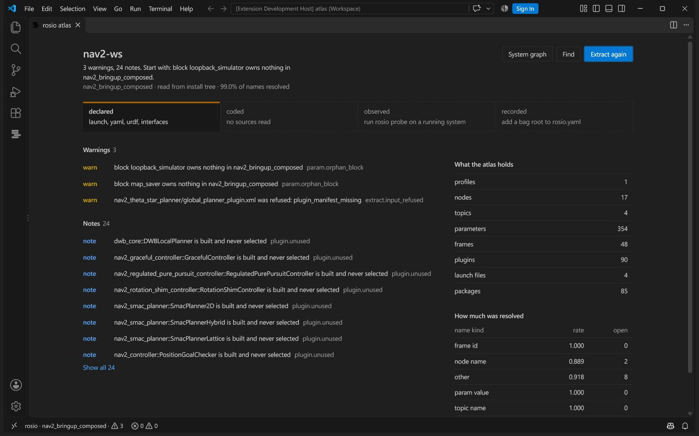
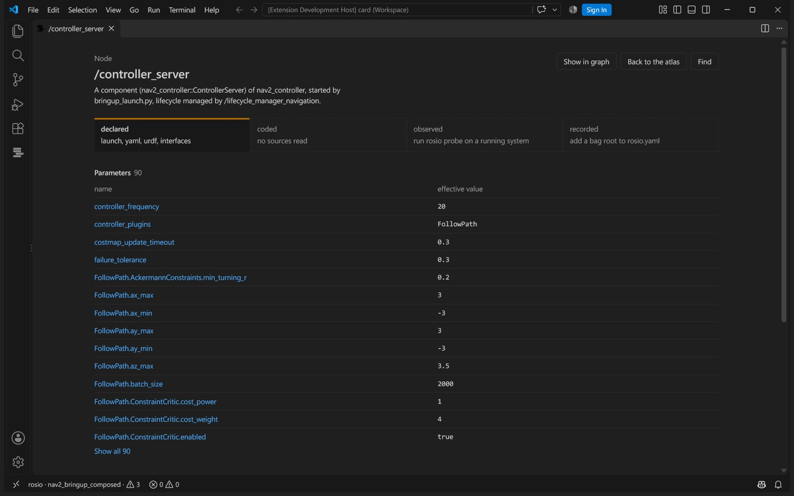

<h1>
  <picture>
    <source media="(prefers-color-scheme: dark)" srcset="https://raw.githubusercontent.com/sa1ntsinner/rosio/main/site/assets/logo-dark.png">
    
  </picture>
</h1>

**What your ROS 2 system really is: written, coded, running and recorded. Where those disagree,
which line to edit, and what rosio could not work out.**

A ROS 2 system is described four times over, in four places, and they rarely agree:

```
declared   launch files, parameter yaml, urdf and xacro, pluginlib manifests, the scripts that start a profile
coded      what the C++ and Python sources actually publish, subscribe, declare and broadcast
observed   a live probe: node names, endpoints with QoS, effective parameters, transforms, the middleware
recorded   rosbag2: topics, types, offered QoS, counts, and the header stamps of every message
```

rosio reads all four into one atlas, reports where they disagree, and puts the answer where you
work: the command line, the editor, CI, and your coding assistant. No language model is involved
in extraction, joining, drift or rendering. Two runs over unchanged inputs produce identical
bytes, so any assistant can use it, including a small local one, with no API key and no network.

## See it

ROS 2 jazzy, stock `nav2_bringup`, composed: the `rosio.yaml` under
[Command reference](#command-reference), then `rosio extract /opt/ros/jazzy`. Does the controller
run on simulated time?

```
$ rosio param /controller_server use_sim_time
use_sim_time on /controller_server   state effective
  profile nav2_bringup_composed
    effective False (bool)   edit nav2_bringup/launch/navigation_launch.py:253 [install]
    rank 0 wins launch_inline_dict   False (bool)
        nav2_bringup/launch/navigation_launch.py:253 [install] SetParameter
```

No parameters file sets it. A `SetParameter` in the launch group does, for every component
the group loads, and that line is the one to edit. Grepping the yaml finds nothing and says
nothing about why.

What does the system get wrong? (The title of each finding; the full output adds the sentence
to quote, the line to edit, a fix and the fingerprint `rosio explain` takes.)

```
$ rosio drift --min-severity warn
3 findings: 0 error, 0 info, 3 warn
  warn  extract.input_refused  nav2_theta_star_planner/global_planner_plugin.xml was refused: plugin_manifest_missing
  warn  param.orphan_block  block loopback_simulator owns nothing in nav2_bringup_composed
  warn  param.orphan_block  block map_saver owns nothing in nav2_bringup_composed
```

The first is a real packaging defect: `nav2_theta_star_planner` exports a plugin manifest by a
name it does not install. The other two are configuration for nodes this profile never starts.

On sources, `examples/rover_ws` is a small rover with five faults planted on purpose (the titles
again):

```
$ rosio drift
5 findings: 1 error, 0 info, 4 warn
  error qos.incompatible  /safety_stop never receives /scan_filtered
  warn  frame.not_in_urdf  /scan_filter looks up laser_frame, which no robot model has
  warn  param.orphan_block  block odometry owns nothing in rover
  warn  param.set_undeclared  stop_distnce is set for /safety_stop and never declared
  warn  param.shadowed  max_range at rover_bringup/config/rover.yaml:4 is overridden
```

A best effort `SensorDataQoS()` publisher and a reliable subscriber in two languages, a frame
name one word off, a parameter key one letter off, a yaml value the launch file overrides, a
block for a node nothing starts. Each is a day lost on a real robot; each is one line here.
`cd examples/rover_ws && rosio extract && rosio drift` reproduces it, with no build.

Is the clock behind a recording sane? Put a known fault into a clean recording and check it (an
excerpt). `--example` writes a small synthetic one; a recording of your own works the same way:

```
$ rosio-bagmutate --example clean_recording
$ rosio-bagmutate clean_recording tai_recording --pathology tai --topic /scan
$ rosio stamps tai_recording
ERROR epoch_offset /scan: /scan offset -36.980 s matches the TAI to UTC offset (37 s), check the PTP timescale or a ptp_utc_tai_offset driver setting, stamps ahead of the receiver

verdict:
  /scan carries a tai utc offset of about 36.980 s while the rest of the system is clean, set the PTP timescale to UTC or correct a ptp_utc_tai_offset style setting on that driver.
```

The usual symptom of that fault is a TF error such as `the timestamp on the message is earlier
than all the data in the transform cache`, printed by a node that is not at fault.
`rosio stamps` reads ROS 1 and ROS 2 bags and needs no ROS installation. The timestamp faults
it knows, what each looks like and how to reproduce it are in
[docs/stamps-failure-zoo.md](docs/stamps-failure-zoo.md).

## Get started

rosio is not on PyPI yet, so it installs from a checkout of this repository. On a stock Ubuntu
24.04 with ROS 2 jazzy:

```bash
sudo apt install git python3-venv    # Ubuntu ships python3 without the venv module
git clone https://github.com/sa1ntsinner/rosio ~/rosio
python3 -m venv --system-site-packages ~/.venvs/rosio && source ~/.venvs/rosio/bin/activate
pip install "$HOME/rosio[cpp,stamps,mcp]"
source /opt/ros/jazzy/setup.bash

cd ~/ros2_ws
rosio init                     # rosio.yaml with one profile per launch file, to edit
rosio extract                  # writes rosio-out/atlas.json here
rosio drift                    # what is wrong, worst first, each with the line to edit
rosio render                   # ATLAS_REPORT.md, DRIFT.md and atlas.html
rosio install claude-code      # register rosio with your assistant
```

With uv instead of the apt package, `uv venv --system-site-packages ~/.venvs/rosio` makes the
environment and `uv pip install "$HOME/rosio[cpp,stamps,mcp]"` installs into it, because a uv
environment has no `pip`. Once a release is on PyPI, `pip install "rosio[cpp,stamps,mcp]"`
replaces the clone.

Every verb reads and writes `rosio-out` in the directory it runs in, and `rosio install` writes
into it too, so run them from the workspace.

Walking a launch tree runs `python3` from your PATH, which is the environment's own interpreter
while it is active. ROS installs part of the `launch` dependency chain as operating system
packages (`lark`, for one) that a plain virtual environment hides, so an active environment
without `--system-site-packages` cannot walk anything, and the run summary says so first, above
the counts.
`mcp` is the extra that `rosio serve` and the server entry `rosio install` writes need.

`init` also takes an install tree, such as `/opt/ros/jazzy` or a built workspace's `install/`.
An installed distribution holds a great many launch files, so name the packages you want. Nobody
writes into `/opt/ros`, so the file goes into the directory you run from:

```bash
mkdir nav2 && cd nav2
rosio init /opt/ros/jazzy --package nav2_bringup --config rosio.yaml
rosio extract /opt/ros/jazzy --config rosio.yaml
```

A build kept apart from the sources is named with
`rosio extract ~/ros2_ws --install-tree ~/builds/ros2_ws/install`.

`extract` writes the model, `render` writes the three things you read:

```
rosio-out/
├── atlas.json        the whole model, queried by the CLI and the editor, never read whole by a person
├── ATLAS_REPORT.md   what this system is, per profile, with the coverage stated honestly
├── DRIFT.md          what is wrong, ordered by severity, each with the line to edit
└── atlas.html        the graph in one self contained file, opens with no network
```

Developed and tested on ROS 2 jazzy with Fast DDS and `rmw_zenoh_cpp`; CI runs jazzy and humble. Python 3.10 and newer.

## In your editor

The VS Code extension in `editors/vscode` puts the atlas next to the code. Findings appear on the
line they cite. Hover over a parameter, a topic or a frame to see every layer that states it.
Go to definition jumps from a topic name in C++ to the remap that renames it. The atlas panel
answers what the system is and what to look at first.



Every node gets a card with its parameters and the value each one ends up with. Every parameter
gets the chain that decided it, winner first, each value one click from the line that set it.



Above every publisher and subscription in C++ and Python, a code lens names the nodes on the
other side and says when their QoS keeps them apart. The Unresolved view lists what the atlas
could not work out, each with the line that asked for it, so a quiet Problems view is never
mistaken for a clean system. With `rosio.extractOnSave` on, findings follow a save.

Show the robot model draws a urdf or xacro model where its joints put each link, with the visual
or collision shapes and the STL and OBJ meshes it names. Clicking a link shows its joint as the
file states it and the line to edit.

The editor side is `rosio-lsp`, a language server written in Rust that indexes the atlas once
when it loads, so a hover or a graph does not walk the file again. Any editor that speaks LSP can use it. The VS Code extension carries it,
and `editors/zed` downloads it from the latest release and wires it into Zed together with the
MCP server. `Ctrl+Alt+R` finds any node, topic, parameter or frame.

## What it does

| | |
| --- | --- |
| **Effective parameter values** | The full candidate chain behind one parameter, winner first, every shadowed value with its file and line, and the mechanism that decided it. It follows a value through a group `SetParameter`, a launch time rewrite, an overlay merge and a Python script that assembles a parameters file, and provenance never terminates at a temp path. |
| **Real topic names** | A code literal plus a launch remap plus a namespace is the topic that actually exists. Neither half states it alone. |
| **Drift between layers** | Forty eight rules with a committed vocabulary and stable waiver keys. Each finding carries a sentence to quote, the line to edit, why it is true and a fix. |
| **Middleware** | Which `RMW_IMPLEMENTATION` every running process was started under, Fast DDS, Cyclone DDS or Zenoh, and whether a Zenoh router is there. Two middlewares in one system, or Zenoh nodes with no router, are errors with the process to fix. |
| **Clocks and stamps** | Backward stamps, frozen and zero stamps, gaps, drift between clocks and offsets that match a known fault (TAI, GPS leap, an unset clock), in a recording and in a live system. |
| **Honest blind spots** | A name built from a variable, a parameter read at runtime, a plugin loaded from a table: all recorded as unresolved with the raw expression, never invented. The resolution rate is a CI gate. |
| **A surface an agent can use** | Twelve tools over MCP, most with the same answer on the command line, every response sized to fit a small context window. |
| **The editor** | Diagnostics, hover, definitions and references across launch, yaml, urdf, C++ and Python, and the atlas panel. |

## Why the answers can be trusted

**Nothing is guessed.** A QoS nobody stated is unknown, not a depth of 10. A namespace nobody stated
is unknown, not the root. Every rule skips facts whose confidence is unknown, and every rule is
scoped to one profile, so a deliberate difference between simulation and the real robot is
configuration rather than drift.

**Silence is a bug, not a feature.** If the launch machinery cannot run, the run summary says so
first, every entry point is marked unloadable with the fix named, and every rule that would
otherwise draw a conclusion from a tree it never read is suppressed.

**Rules that cannot speak stay quiet.** A rule that needs the running system waits for the observed layer, because
with only part of the sources read a missing subscriber usually means a file was not parsed.

**Every fact cites a file and a line**, inline, so a slice of the atlas is self sufficient and a
finding stays actionable when it is pasted into a chat with no context around it.

## Works with your assistant

`rosio install` writes the files your assistant reads. Four mechanisms cover most tools: a skill
file, a section in an instruction file, a rules file, and an MCP server registration.

```bash
rosio install --list                   # the table: platform, mechanism, and the exact paths
rosio install claude-code              # this repository, which is the default scope
rosio install codex --scope user       # your user profile instead
rosio install cursor --dry-run         # print what would be written, write nothing
rosio uninstall claude-code            # put the tree back
```

A project file such as `.mcp.json` is committed, so its server entry runs `rosio serve --atlas
rosio-out/atlas.json` from the PATH, in the project directory the assistant starts it in, and
works in every clone. When `rosio` is not on a minimal PATH, install says so: `--scope user`
registers the interpreter that ran install by its absolute path instead.

Claude Code, Codex, Cursor, Gemini CLI, GitHub Copilot, Aider, OpenCode, Amp, Kilo, and the cross
framework agent skills directory. Anything that speaks MCP can use the server directly:

```bash
rosio serve                                        # stdio
rosio serve --http --host 0.0.0.0 --api-key "$KEY" # one server for a team
```

Twelve tools: `overview`, `param_chain`, `drift`, `explain`, `query`, `path`, `neighbours`,
`graph`, `unresolved`, `stamps`, `transform`, `migrate`. Every response is capped and says when it truncated and how to narrow the question.
Arguments carry the command line's names (`only` as in `--only`, `source` and `target` as in
`rosio path`), except that `migrate` takes `start` for `--from` and accepts `from` too. An
argument a tool does not take is refused with the names it does.
The server starts without an atlas, and each tool then names the extract command that builds one.
Over `--http`, `migrate` reads only the served workspace: the directory `--workspace` names, else
the one above the `rosio-out` that holds the atlas, else the directory of the atlas itself.
A worst case answer is under 4 KB. On very small models prefer the command
line, where the skill file is 3.3 KB and carries six commands, the waiver file and a worked example.

## Privacy

Everything runs locally. Code, launch files, parameters and recordings are parsed on your machine
and nothing is uploaded. There is no telemetry and no network call anywhere in extraction, drift
or rendering. The MCP server binds to loopback and refuses to bind wider without an API key.

Python launch files are executed to read the description they build, the way `ros2 launch`
does before it starts anything. Every attempt to start a process during that walk is refused
and noted in the run. With a working `bwrap` (the `bubblewrap` apt package), the walk uses
a read only filesystem, private temporary and ROS log directories, and no network access.
Otherwise it keeps your user's file and network access. `launch_sandbox: required` in
`rosio.yaml` refuses that fallback, and `rosio extract --launch-sandbox off` disables isolation.
The default is `auto`. Only extract workspaces you would also `ros2 launch`.

## Troubleshooting

**The atlas has almost no nodes and no parameters.** Your virtual environment hides the system
packages, so the launch layer never ran. The run summary says so first and names the fix:
recreate the environment with `--system-site-packages`.

**`pytest` ends in a `PluginValidationError` before any test runs.** With a ROS setup sourced,
humble registers `launch_testing` as a pytest11 plugin whose hook signature no current pytest
accepts, so run the suite with `PYTEST_DISABLE_PLUGIN_AUTOLOAD=1`.

**`rosio: command not found`.** The install directory is not on your PATH. `pipx ensurepath` or
`uv tool update-shell`, then open a new shell.

**A launch file raised.** Read the reason in the run summary, and `rosio drift` names the fix. A
launch file that needs an argument you did not supply is the common one, and profiles in
`rosio.yaml` are where arguments live. An environment variable such as a robot model name goes
under `env` of the profile, and a package no root holds is installed or added as a root.

**The C++ collector refuses.** `pip install "$HOME/rosio[cpp]"`, from the checkout of Get
started. Without it the coded layer covers Python only, rosio records that rather than pretending
otherwise, and the atlas carries one `extract.pass_incomplete` at error, so
`rosio drift --fail-on error` exits 5.

**`rosio stamps` says it needs the stamps extra.** `pip install "$HOME/rosio[stamps]"`, which
brings `rosbags`, the reader that needs no ROS installation.

## Command reference

```
rosio init [--force] [--print] [--package NAME] [--config FILE] [PATH]  # write rosio.yaml: roots, setup files, profiles to edit
rosio extract [--layer {declared,coded}] [--launch-sandbox {auto,required,off}] [--install-tree DIR] [--profile NAME] [--config FILE] [--collector NAME] [--bag PATH] [--no-runtime] [--fail-on-violation] [PATH]
rosio stamps [--topics TOPIC] [--limit N] [--json-verdict] [--stats] [BAG]
rosio probe [--stamps] [--duration SECONDS] [--settle SECONDS] [--domain-id N] [--localhost-only] [--rmw NAME] [--ros-setup FILE] [--profile NAME] [--config FILE] [--atlas FILE] [PATH]
rosio drift [--fail-on {error,warn,info,never}] [--min-severity {error,warn,info}] [--only RULE] [--waivers FILE] [--config FILE] [--atlas FILE] [--limit N]
rosio param [--profile NAME] [--atlas FILE] [--limit N] [SELECTOR ...]
rosio explain [--atlas FILE] [--limit N] [SELECTOR]
rosio query [--atlas FILE] [--limit N] [WORDS ...]
rosio path [--max-hops N] [--atlas FILE] [--limit N] [SOURCE] [TARGET]
rosio unresolved [--want WANT] [--atlas FILE] [--limit N]
rosio graph [--profile NAME] [--focus NODE_OR_CHANNEL] [--depth N] [--wrappers] [--format {text,dot,mermaid}] [--atlas FILE] [--limit N]
rosio diff [--profile NAME] [--rev REV] [--repo DIR] [--cache-rules] [--workspace PATH] [--atlas FILE] [--limit N] [BEFORE] [AFTER]
rosio render [--format {md,html}] [--atlas FILE] [--limit N]
rosio install [--list] [--scope SCOPE] [--root DIR] [--home DIR] [--dry-run] [--force] [TARGET]
rosio uninstall [--scope SCOPE] [--root DIR] [--home DIR] [--dry-run] [--force] [TARGET]
rosio serve [--atlas FILE] [--stdio | --http] [--host ADDR] [--port N] [--api-key KEY] [--path PATH] [--stateless] [--workspace DIR]
rosio hook install [--repo DIR] [--python PATH] [--workspace PATH] [--config FILE] [--force] [--dry-run] [--no-measure]
rosio hook status [--repo DIR]
rosio hook uninstall [--repo DIR] [--force] [--dry-run]
rosio hook run [--repo DIR] [--event NAME] [--no-cache]
rosio hook merge [--path PATH] [--result FILE] BASE OURS THEIRS  # the merge driver git calls for atlas.json
rosio bundle create [--out FILE] [--atlas FILE] [--include {findings,cited}] [--note TEXT] [PATH]
rosio bundle open [--into DIR] [--force] FILE
rosio migrate plan [--config FILE] [--from RELEASE] --to RELEASE [PATH]
rosio migrate apply [--config FILE] [--from RELEASE] --to RELEASE [--force] [PATH]
rosio migrate verify [--config FILE] [--from RELEASE] --to RELEASE [--image NAME] [PATH]
rosio version
```

The output flags `--out DIR`, `--json`, `--quiet`, `--deterministic` and `--no-deterministic`
are left out of the lines above; `rosio <verb> --help` says which of them a verb takes.

Use `rosio probe --stamps --duration 10` to check header stamps in the running system.

`probe` detects middleware implementations from node and launcher environments and runs one
isolated child per implementation. Repeat `--rmw NAME` to force the passes, for example
`--rmw default --rmw rmw_zenoh_cpp`. `default` unsets `RMW_IMPLEMENTATION` after sourcing.
Node facts carry `seen_through`, and refused passes remain on the observed run.

`hook` is the git side: it writes the hooks that rebuild the atlas after a commit, a checkout and
a merge, and registers the merge driver that resolves two rebuilds of `atlas.json` without conflict
markers. It is not part of `install`, which registers rosio with an assistant, because the two
share no flag.

Configuration lives in `rosio.yaml`: the roots to read, and one profile per system you actually
run, each naming its entry points and their arguments. No single launch file describes a running
robot, so a profile is an ordered set of entry points rather than one file. Every key, its
default and where the file is looked for are in [docs/configuration.md](docs/configuration.md).

```yaml
roots:
  - kind: install
    path: /opt/ros/jazzy
ros_setup:
  - /opt/ros/jazzy/setup.bash
ignore:
  - /include
  - /opt
  - /lib/python*
profiles:
  - slug: nav2_bringup_composed
    entrypoints:
      - launch: nav2_bringup bringup_launch.py
        args:
          use_composition: "True"
```

`ignore` keeps the headers, vendored libraries and python modules of the prefix out of the index,
which rosio reads nothing from.

## Moving to another ROS 2 release

Humble ends in May 2027. `rosio migrate` lists what moving a workspace from one release to another
asks of its own packages, with the file and line of each change and the source that says so:

```bash
rosio migrate plan --from humble --to lyrical     # every change, edits nothing
rosio migrate apply --from humble --to lyrical    # the exact rewrites, and the diff in rosio-out/migrate/
rosio migrate verify --from humble --to lyrical   # build in the target and match errors to the plan
```

What it knows comes from two kinds of source. Measured facts: which packages rosdistro releases for each
release, and which headers the official `ros:<release>` images install, with common ROS
packages (ros2_control, nav2, cv_bridge and BehaviorTree.CPP) and system development libraries
(Ceres, OpenCV and PCL) added, and the parameters nav2 nodes declare in
each release, read from the nav2 sources, so a parameter file learns which keys a node now ignores
and which unset keys changed their default. A short table of hand written rules
for what a measurement cannot see: a renamed API, a CMake function that is gone, a remapping that
silently stops applying, each with its upstream source. Nothing is recalled from release notes.

A change is either an exact rewrite (a header's new spelling or a renamed class) or one sentence for the person making it.
`apply` performs only the first kind, refuses files with uncommitted edits, and states for each
rewrite the oldest release where the new form builds, so a package that supports both ends knows
whether it can take the change today.

Finish with `verify`. It copies the source packages into a disposable Docker container,
installs dependencies with rosdep and builds with colcon. It uses a local
`rosio-facts:<release>` image when present, otherwise `ros:<release>-ros-base`;
`--image NAME` selects another image. Docker must be installed and running. Nothing is
built in the workspace. The report lists finished, failed and skipped packages, each
error as `listed` with the plan's rule and sentence or `not_listed`, and the plan changes
still open. Matching uses the same package, file and the lines the planned expression
spans, so it states location correspondence rather than proving the cause of an error.
`--json` returns the same report as data. A complete build exits 0, a failed or incomplete
build exits 1, and unavailable Docker exits 2.

In VS Code the plan appears as diagnostics with quick fixes and in a Migration view, by hand
changes first. Verify build runs `migrate verify` and lists each package that fails in the target,
errors the plan does not cover first. Agents get the same plan from the `migrate` tool, which hands the exact rewrites to
`apply` instead of asking a model to retype them.

## Handing a problem over

A robot that misbehaves on one machine is usually debugged by somebody on another. `rosio bundle`
puts the atlas, both reports, the files the findings cite, the configuration and the git revision
into one archive, and the person who opens it gets the same findings pointing at the same lines,
without the workspace, a build or a ROS installation.

```bash
rosio bundle create . --note "safety stop never triggers"
rosio bundle open rosio-out/bundle.rosio.zip --into problem
```

`open` unpacks into a directory whose `files/` tree stands in for the sender's workspace, writes
a `rosio.yaml` pointing at it, and prints the most severe findings with the file and line to edit.
`rosio drift`, `rosio explain` and the editor extensions all work on it as they do on a checkout.

What goes in:

- by default the files the findings cite, plus each package's `package.xml`; `--include cited`
  takes every file any evidence row cites, up to 2000 files and 50 MiB;
- the uncommitted text changes as `changes.diff`, up to 5 MiB, binary changes left out;
- a `manifest.json` listing every file that was left out and why.

Values whose name matches `password`, `passwd`, `secret`, `token`, `api_key` or `private_key`
are replaced by `<redacted>` in yaml, launch argument defaults and `name:=value` arguments, and
environment blocks are removed. That is a rule on names, so a credential stored under an unrelated
name has to be removed by hand before sending. Line counts stay as they were, so every cited line
still points at the right place. Two creates over the same state write the same bytes.

## Waiving a finding you have already decided about

A team that cannot silence one known finding turns the whole gate off. `rosio drift` takes a
waiver file, and it is the only verb that does: a waiver decides how a finding is graded, never
whether it is in the atlas, so a machine with the file and a machine without one still extract the
same bytes.

```yaml
# rosio-waivers.yaml
waivers:
  - key: find:extract.input_refused|file:nav2_theta_star_planner%7Cglobal_planner_plugin.xml|-
    reason: upstream packaging defect, reported to nav2
  - key: sha256:dd3e814875c51fa4
    reason: third party package, tracked in ticket ROS-412
```

Two keys and nothing else. A `key` is a finding id or a `sha256:` fingerprint, both printed by
`rosio drift --json`, and a rule id is refused rather than accepted: it reads like one finding and
would silence a whole rule. A `reason` is mandatory.

```bash
rosio drift --waivers rosio-waivers.yaml --fail-on error
```

The flag is repeatable (`--waivers FILE`) and wins whole over the `waivers` key of `rosio.yaml`.
A waived finding is still printed, and under the findings comes what the waivers did:

```
  1 of 2 waivers matched, printed above and not graded by --fail-on
        waived find:extract.input_refused|file:nav2_theta_star_planner%7Cglobal_planner_plugin.xml|-
          upstream packaging defect, reported to nav2
        waiver matched nothing, delete it: sha256:dd3e814875c51fa4
```

A key that matches nothing says so every run, so a waiver that went stale when its finding was
fixed reports itself instead of quietly widening the file.

## Contributing

`AGENTS.md` is the contract every module obeys: identity, layers, facts, findings and determinism.
`ARCHITECTURE.md` is the map. `CONTEXT.md` is the vocabulary. The most useful report is a workspace
or a recording that rosio reads wrongly, with what it should have said.

## Licence

Apache-2.0.
