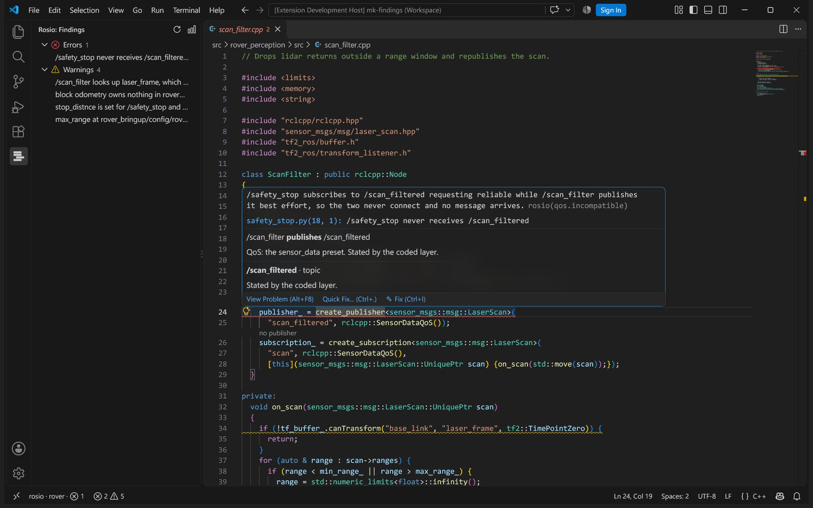
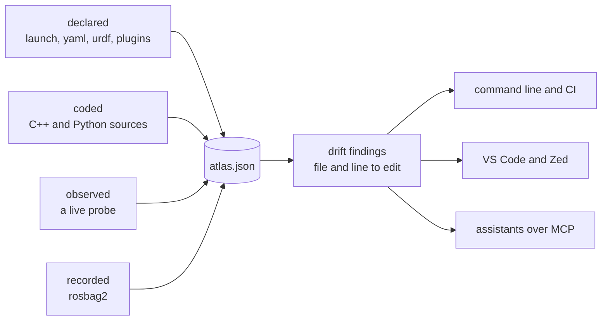
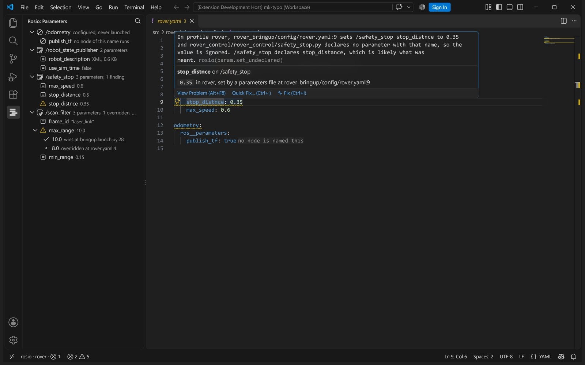

<p align="center">
  <picture>
    <source media="(prefers-color-scheme: dark)" srcset="https://raw.githubusercontent.com/sa1ntsinner/rosio/main/docs/media/logo-dark.svg">
    
  </picture>
</p>

<p align="center">
  <b>What your ROS 2 system really is, where its parts disagree, and which line to edit.</b><br>
  <a href="https://sa1ntsinner.github.io/rosio-site/">Site</a> ·
  <a href="https://github.com/sa1ntsinner/rosio/blob/main/docs/commands.md">Commands</a> ·
  <a href="https://github.com/sa1ntsinner/rosio/blob/main/docs/configuration.md">Configuration</a> ·
  <a href="https://github.com/sa1ntsinner/rosio/blob/main/docs/examples.md">Examples</a> ·
  <a href="https://github.com/sa1ntsinner/rosio/blob/main/docs/assistants.md">Assistants</a>
</p>



A ROS 2 system is described four times: in launch files and yaml, in the C++ and Python
sources, in the running graph, and in the recordings. rosio reads all four into one atlas and
tells you where they disagree, with the file and line to change. There is no language model in
it, no network call and no API key, and two runs over the same inputs write the same bytes.



## Quickstart

```bash
pip install "rosio[cpp,stamps,mcp]"      # in an environment made with --system-site-packages
source /opt/ros/jazzy/setup.bash
cd ~/ros2_ws
rosio init        # writes rosio.yaml, one profile per launch file
rosio extract     # reads the workspace into rosio-out/atlas.json
rosio drift       # what is wrong, worst first
```

On `examples/rover_ws`, a small rover with five faults planted on purpose:

```
$ rosio drift
5 findings: 1 error, 0 info, 4 warn
  error qos.incompatible  /safety_stop never receives /scan_filtered
  warn  frame.not_in_urdf  /scan_filter looks up laser_frame, which no robot model has
  warn  param.orphan_block  block odometry owns nothing in rover
  warn  param.set_undeclared  stop_distnce is set for /safety_stop and never declared
  warn  param.shadowed  max_range at rover_bringup/config/rover.yaml:4 is overridden
```

Each finding also carries why it is true, the line to edit, a fix and a sentence an assistant
can quote. `rosio param`, `rosio path` and `rosio explain` answer one question each, and
`rosio render` writes a report and a single file graph. Profiles, roots and every other key
are in [docs/configuration.md](https://github.com/sa1ntsinner/rosio/blob/main/docs/configuration.md); installing from a checkout and the
full command list are in [docs/commands.md](https://github.com/sa1ntsinner/rosio/blob/main/docs/commands.md).

## What it finds

| | |
| --- | --- |
| **Effective parameters** | The chain behind one value, winner first, every shadowed value with its file and line, through `SetParameter`, rewritten yaml and launcher scripts. |
| **Real names** | A code literal plus a remap plus a namespace is the topic that exists. |
| **Drift** | Fifty seven rules with a committed vocabulary and stable waiver keys. |
| **Middleware and clocks** | Mixed RMW implementations, a missing Zenoh router, and header stamps that go backwards, freeze or carry a TAI offset. |
| **Blind spots** | What it could not work out is listed with the raw expression, never guessed. |

## In your editor



The VS Code extension in `editors/vscode` puts findings on the line they cite, hovers show
every layer that states a topic, parameter or frame, and code lenses name the other end of each
publisher and subscription. The editor side is `rosio-lsp`, a Rust language server any LSP
editor can use; `editors/zed` wires it into Zed. More screenshots are in
[docs/examples.md](https://github.com/sa1ntsinner/rosio/blob/main/docs/examples.md).

## With your assistant

```bash
rosio install claude-code     # or codex, cursor, gemini-cli, copilot, aider, ...
rosio serve                   # the MCP server, over stdio
```

`install` writes the skill, rules and MCP registration your assistant reads. Details, the tool
list and the privacy model are in [docs/assistants.md](https://github.com/sa1ntsinner/rosio/blob/main/docs/assistants.md).

## More

- [Moving to another ROS 2 release](https://github.com/sa1ntsinner/rosio/blob/main/docs/migrate.md): `rosio migrate plan --to lyrical` lists
  what the move asks of your packages, and `verify` builds them in the target.
- [Handing a problem over](https://github.com/sa1ntsinner/rosio/blob/main/docs/bundle.md): `rosio bundle create` packs the atlas and the cited
  files so someone else sees the same findings.
- [Timestamp faults](https://github.com/sa1ntsinner/rosio/blob/main/docs/stamps-failure-zoo.md): what `rosio stamps` detects in a recording.
- `AGENTS.md` is the contract, `ARCHITECTURE.md` the map, `CONTEXT.md` the vocabulary.

Developed on ROS 2 jazzy with Fast DDS and `rmw_zenoh_cpp`; CI runs jazzy and humble on
Python 3.10 and newer. The most useful report is a workspace or a recording rosio reads wrongly.
Apache-2.0.
