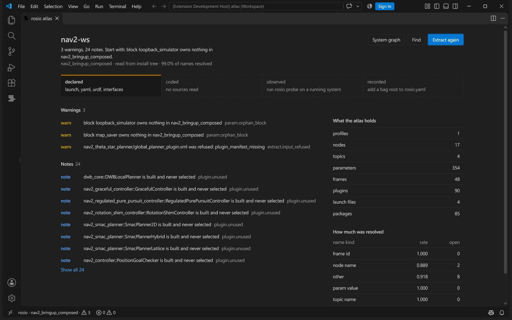
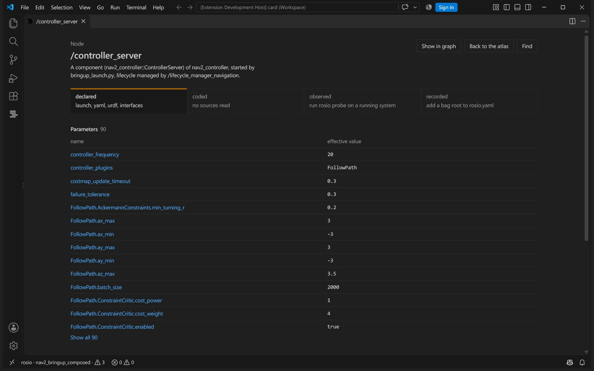

# Examples

ROS 2 jazzy, stock `nav2_bringup`, composed: the `rosio.yaml` under
[Command reference](commands.md#command-reference), then `rosio extract /opt/ros/jazzy`. Does the controller
run on simulated time?

```
$ rosio param /controller_server use_sim_time
use_sim_time on /controller_server   state effective
  profile nav2_bringup_composed
    effective False (bool)   edit nav2_bringup/launch/navigation_launch.py:253 [install]
    rank 0 wins launch_inline_dict   False (bool)
        nav2_bringup/launch/navigation_launch.py:253 [install] SetParameter
```

No parameters file sets it. A `SetParameter` in the launch group does, for every component
the group loads, and that line is the one to edit. Grepping the yaml finds nothing and says
nothing about why.

What does the system get wrong? (The title of each finding; the full output adds the sentence
to quote, the line to edit, a fix and the fingerprint `rosio explain` takes.)

```
$ rosio drift --min-severity warn
3 findings: 0 error, 0 info, 3 warn
  warn  extract.input_refused  nav2_theta_star_planner/global_planner_plugin.xml was refused: plugin_manifest_missing
  warn  param.orphan_block  block loopback_simulator owns nothing in nav2_bringup_composed
  warn  param.orphan_block  block map_saver owns nothing in nav2_bringup_composed
```

The first is a real packaging defect: `nav2_theta_star_planner` exports a plugin manifest by a
name it does not install. The other two are configuration for nodes this profile never starts.

On sources, `examples/rover_ws` is a small rover with five faults planted on purpose (the titles
again):

```
$ rosio drift
5 findings: 1 error, 0 info, 4 warn
  error qos.incompatible  /safety_stop never receives /scan_filtered
  warn  frame.not_in_urdf  /scan_filter looks up laser_frame, which no robot model has
  warn  param.orphan_block  block odometry owns nothing in rover
  warn  param.set_undeclared  stop_distnce is set for /safety_stop and never declared
  warn  param.shadowed  max_range at rover_bringup/config/rover.yaml:4 is overridden
```

A best effort `SensorDataQoS()` publisher and a reliable subscriber in two languages, a frame
name one word off, a parameter key one letter off, a yaml value the launch file overrides, a
block for a node nothing starts. Each is a day lost on a real robot; each is one line here.
`cd examples/rover_ws && rosio extract && rosio drift` reproduces it, with no build.

Is the clock behind a recording sane? Put a known fault into a clean recording and check it (an
excerpt). `--example` writes a small synthetic one; a recording of your own works the same way:

```
$ rosio-bagmutate --example clean_recording
$ rosio-bagmutate clean_recording tai_recording --pathology tai --topic /scan
$ rosio stamps tai_recording
ERROR epoch_offset /scan: /scan offset -36.980 s matches the TAI to UTC offset (37 s), check the PTP timescale or a ptp_utc_tai_offset driver setting, stamps ahead of the receiver

verdict:
  /scan carries a tai utc offset of about 36.980 s while the rest of the system is clean, set the PTP timescale to UTC or correct a ptp_utc_tai_offset style setting on that driver.
```

The usual symptom of that fault is a TF error such as `the timestamp on the message is earlier
than all the data in the transform cache`, printed by a node that is not at fault.
`rosio stamps` reads ROS 1 and ROS 2 bags and needs no ROS installation. The timestamp faults
it knows, what each looks like and how to reproduce it are in
[stamps-failure-zoo.md](stamps-failure-zoo.md).

## In your editor

The VS Code extension in `editors/vscode` puts the atlas next to the code. Findings appear on the
line they cite. Hover over a parameter, a topic or a frame to see every layer that states it.
Go to definition jumps from a topic name in C++ to the remap that renames it. The atlas panel
answers what the system is and what to look at first.



Every node gets a card with its parameters and the value each one ends up with. Every parameter
gets the chain that decided it, winner first, each value one click from the line that set it.



Above every publisher and subscription in C++ and Python, a code lens names the nodes on the
other side and says when their QoS keeps them apart. The Unresolved view lists what the atlas
could not work out, each with the line that asked for it, so a quiet Problems view is never
mistaken for a clean system. With `rosio.extractOnSave` on, findings follow a save.

Show the robot model draws a urdf or xacro model where its joints put each link, with the visual
or collision shapes and the STL and OBJ meshes it names. Clicking a link shows its joint as the
file states it and the line to edit.

The editor side is `rosio-lsp`, a language server written in Rust that indexes the atlas once
when it loads, so a hover or a graph does not walk the file again. Any editor that speaks LSP can use it. The VS Code extension carries it,
and `editors/zed` downloads it from the latest release and wires it into Zed together with the
MCP server. `Ctrl+Alt+R` finds any node, topic, parameter or frame.

## Why the answers can be trusted

**Nothing is guessed.** A QoS nobody stated is unknown, not a depth of 10. A namespace nobody stated
is unknown, not the root. Every rule skips facts whose confidence is unknown, and every rule is
scoped to one profile, so a deliberate difference between simulation and the real robot is
configuration rather than drift.

**Silence is a bug, not a feature.** If the launch machinery cannot run, the run summary says so
first, every entry point is marked unloadable with the fix named, and every rule that would
otherwise draw a conclusion from a tree it never read is suppressed.

**Rules that cannot speak stay quiet.** A rule that needs the running system waits for the observed layer, because
with only part of the sources read a missing subscriber usually means a file was not parsed.

**Every fact cites a file and a line**, inline, so a slice of the atlas is self sufficient and a
finding stays actionable when it is pasted into a chat with no context around it.
