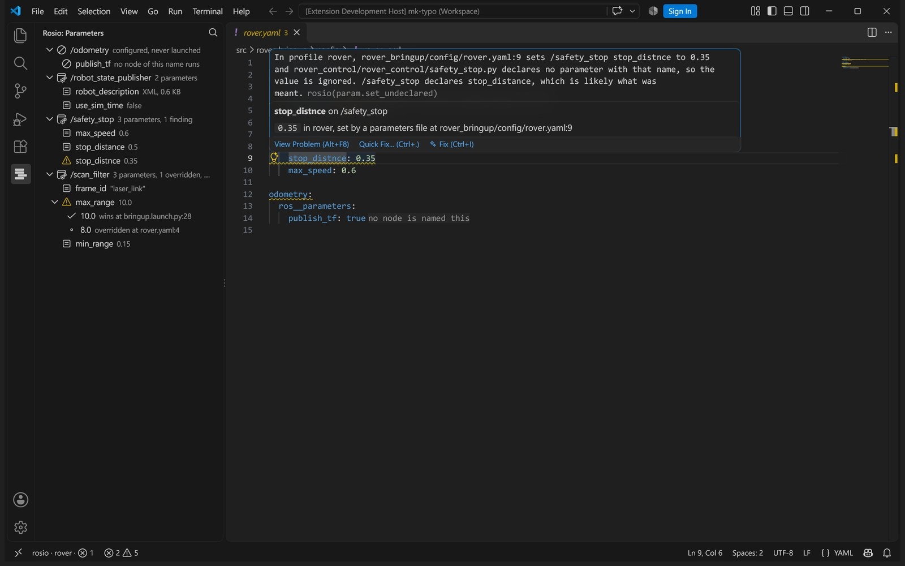
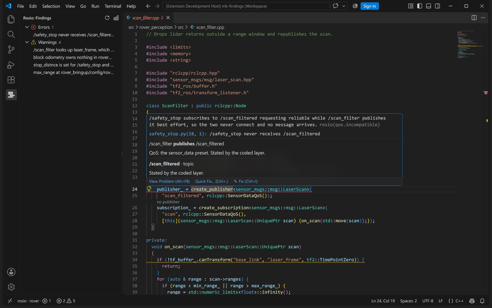
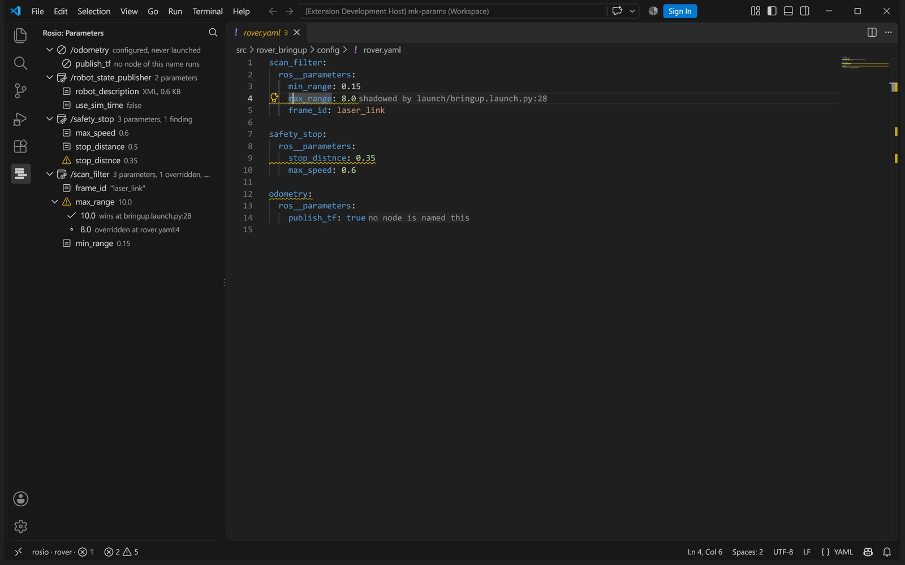
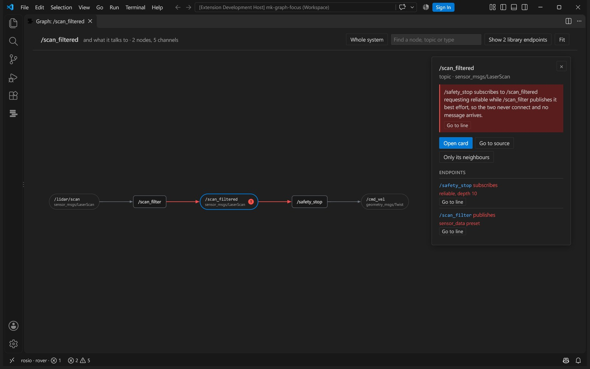
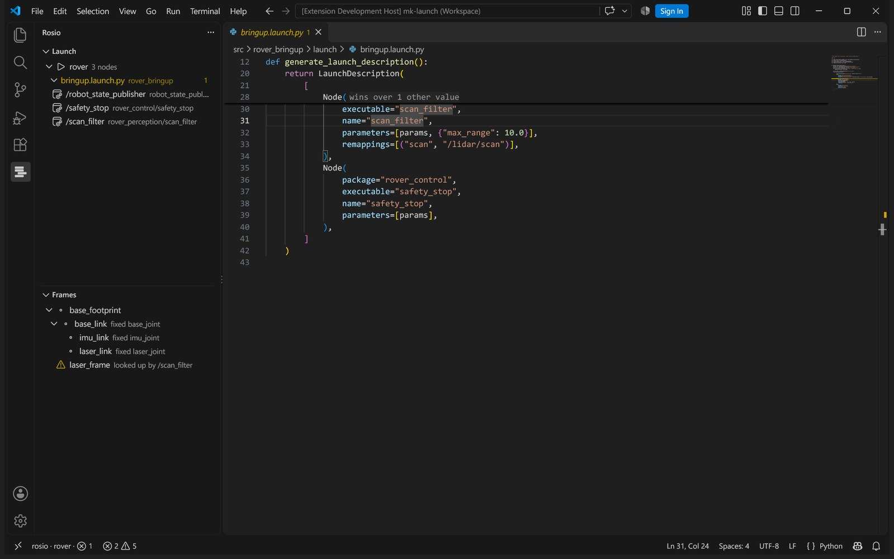
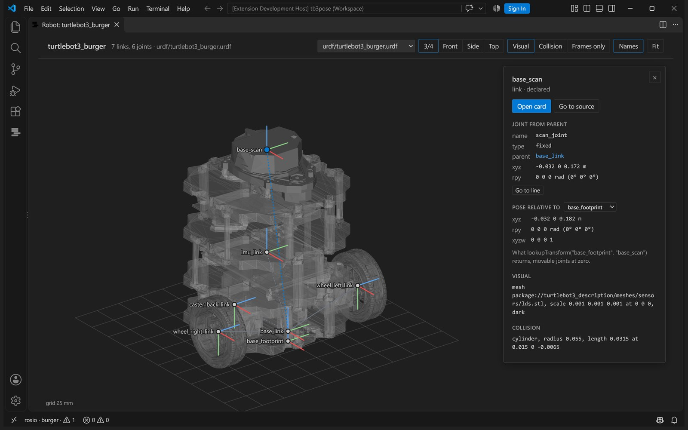

# rosio for VS Code

Your ROS 2 system as the code, the launch files and the parameter files describe it, read without
starting anything. Where they disagree, rosio puts the finding on the line to edit.

## Findings on the line they cite

A parameter no node declares, a subscription whose QoS can never match its publisher, a frame
the code looks up that nothing broadcasts, a block for a node that is never launched. Each one
sits in the Problems view and on the line itself, with the sentence that says what to change.

Above every `create_publisher` and `create_subscription` is the node on the other end of the
topic, and whether the QoS lets them connect.

## Where every parameter value comes from

The Parameters view lists what each profile sets, node by node, with the value the node ends up
with. Expand an overridden one to see every line it beat. In a parameters file, a line that loses
says which line wins.

## The system graph

What `rqt_graph` shows, drawn from the sources, so it works before the robot does. Data flows
from each publisher through its topic to every subscriber, with the message type under each
topic. Click a box for its endpoints and their QoS; double click to keep only what it talks to.

## What a launch file starts

The Launch view walks each profile with its includes resolved: every node by the name it runs
under, the executable behind it and the condition that gates it. The Frames view is the transform
tree of each robot model, with the joint behind every frame.

Show the robot model draws a URDF where its joints put each link, with the visual or collision
shapes and the STL and OBJ meshes it names. Click a link for its joint as the file states it, the line to
edit, and its pose relative to any other frame of the model.

## Also

- **Moving to another ROS 2 release.** Plan a move from humble to jazzy or later, apply the
  exact rewrites in one step, and build the result in the target release to see what is left.
- **Hover and go to definition across languages,** from a topic name in C++ to the remap that
  renames it, from a parameter in yaml to its `declare_parameter`.
- **What rosio could not work out.** The Unresolved view lists every name built at run time, so a
  missing finding is never mistaken for a clean system.
- **Find anything** with `Ctrl+Alt+R`: a node, topic, parameter, frame or package.

## Requirements

- The `rosio` engine where the workspace is: `pipx install rosio`, or `pip install rosio` in a
  virtual environment created with `--system-site-packages`, with your ROS 2 setup sourced.
- Run **rosio: Extract the atlas** once. The language server ships inside the extension.

On Windows, open the workspace in WSL or over SSH with the Remote extensions; the extension runs
where the workspace is.

## Settings

| setting | default | meaning |
| --- | --- | --- |
| `rosio.command` | `["rosio"]` | the rosio command, as an argument list |
| `rosio.extractArgs` | `["extract", "."]` | arguments for extraction, for example `["extract", "--config", "rosio.yaml"]` |
| `rosio.extractOnSave` | `false` | extract again when a file the atlas cites is saved |
| `rosio.codeLens` | `true` | show endpoint peers and QoS warnings; restart the language server after changing |
| `rosio.atlasPath` | `rosio-out/atlas.json` | where the atlas is, relative to the workspace folder |
| `rosio.server.path` | empty | a language server to use instead of the one in the extension |

## Privacy

Everything runs on your machine. Nothing is uploaded and there is no telemetry.

Apache-2.0.
